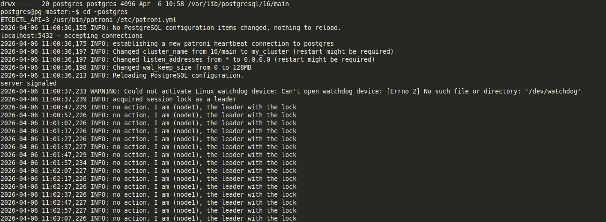
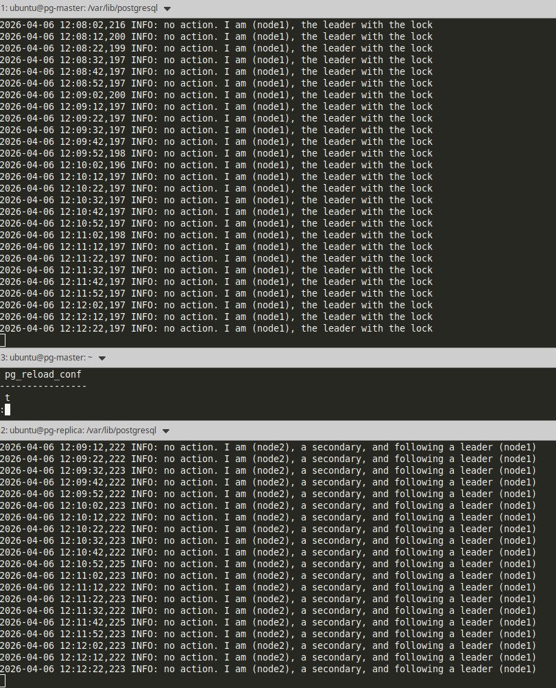
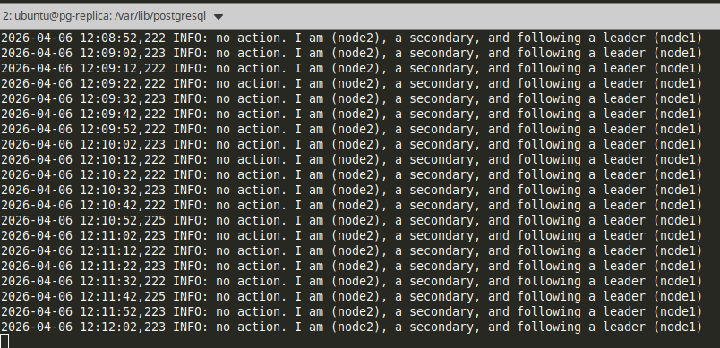
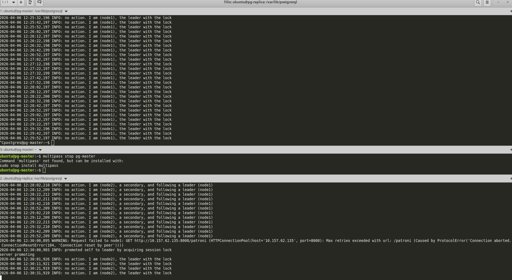
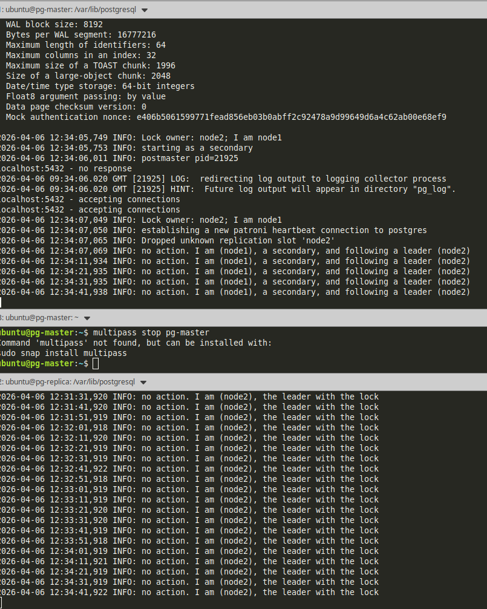

## Устновка Patroni на master

Установка `etcd`
```bash
sudo snap install etcd
```

Установка Patroni
```bash
# Установить инструменты для venv
sudo apt install python3-venv python3-full

# Создать окружение
python3 -m venv ~/patroni_venv

# Установите patroni с поддержкой etcd внутри окружения
~/patroni_venv/bin/pip install patroni[etcd]
```

Вот компактная, готовая версия для **README**, чтобы поднять etcd с v2 API для Patroni на одиночном узле:

## Настройка etcd для Patroni (v2 API)

1. **Очистка старых данных и остановка сервиса**:

```bash
sudo systemctl stop etcd
sudo rm -rf /var/lib/etcd
sudo mkdir -p /var/lib/etcd
sudo chown -R etcd:etcd /var/lib/etcd
````

2. **Создание override для systemd**:

```bash
sudo mkdir -p /etc/systemd/system/etcd.service.d
sudo nano /etc/systemd/system/etcd.service.d/override.conf
```

Вставьте:

```ini
[Service]
Environment=
ExecStart=
ExecStart=/usr/bin/etcd \
  --name=pg-master \
  --data-dir=/var/lib/etcd \
  --listen-client-urls=http://0.0.0.0:2379 \
  --advertise-client-urls=http://10.157.62.135:2379 \
  --listen-peer-urls=http://0.0.0.0:2380 \
  --initial-advertise-peer-urls=http://10.157.62.135:2380 \
  --initial-cluster=pg-master=http://10.157.62.135:2380 \
  --initial-cluster-state=new \
  --initial-cluster-token=etcd-cluster-1 \
  --enable-v2=true
```

3. **Очистка `/etc/default/etcd`**:

```bash
sudo mv /etc/default/etcd /etc/default/etcd.bak
```

4. **Перезагрузка systemd и запуск etcd**:

```bash
sudo systemctl daemon-reload
sudo systemctl start etcd
sudo systemctl status etcd
```

5. **Проверка API v2**:

```bash
curl http://10.157.62.135:2379/v2/machines
```

> Должно вернуть: `http://10.157.62.135:2379`


## Теперь Patroni успешно стартовал и нода **стала лидером**. 


### Что мы сделали, чтобы это сработало:

1. **Создали роли в PostgreSQL**:

```sql
CREATE ROLE replicator WITH REPLICATION LOGIN PASSWORD 'mysecret';
ALTER USER postgres WITH PASSWORD 'mysecret';
```

2. **Настроили Patroni (`patroni.yml`)** с правильными паролями:

```yaml
postgresql:
  listen: 0.0.0.0:5432
  connect_address: 10.157.62.135:5432
  data_dir: /var/lib/postgresql/16/main
  bin_dir: /usr/lib/postgresql/16/bin
  authentication:
    replication:
      username: replicator
      password: mysecret
    superuser:
      username: postgres
      password: mysecret
```

3. **Исправили `/var/lib/postgresql/16/main/pg_hba.conf`**, чтобы TCP и локальные подключения для суперпользователя и репликатора проходили через `scram-sha-256` или `md5`.
```conf
# Разрешить подключение для пользователя-репликатора со всех IP
host    replication     replicator     0.0.0.0/0            scram-sha-256
```

4. **Убедились, что права на каталог данных** `/var/lib/postgresql/16/main` принадлежат `postgres`:

```bash
drwx------  postgres postgres /var/lib/postgresql/16/main
```

5. **Запускали Patroni строго от пользователя `postgres`**, из его домашнего каталога:

```bash
sudo -i -u postgres
cd ~postgres
ETCDCTL_API=3 /usr/bin/patroni /etc/patroni.yml
```

---

✅ Теперь кластер работает:

* Нода `node1` — **лидер**
* PostgreSQL принимает соединения на 0.0.0.0:5432
* Репликация готова к подключению слейвов
* Patroni управляет кластером автоматически


 ## Имитация Failover
После выключения мастера реплика становится лидером
## Мониторинг и проверка отказоустойчивости

### Текущее состояние кластера
На скриншоте ниже показано стандартное состояние кластера, где один узел является Лидером, а второй — Репликой:


### Схема связности Master-Replica
Визуализация сетевого взаимодействия между компонентами PostgreSQL и Patroni:


### Проверка Role Switch (Лидер на Реплике)
Подтверждение того, что узел реплики может принимать на себя роль лидера:


### Отработка Failover
Скриншот терминала в момент падения мастера. Видно, как Patroni переключает роль лидера на второй узел:


### 4. Восстановление после сбоя (Reinitialization)

После того как упавший узел `pg-master` возвращается в сеть, Patroni автоматически перенастраивает его как новую реплику для текущего лидера.

### 5. Состояние кластера после восстановления мастера:**

*На скриншоте видно, что `pg-replica` остается в роли **Leader**, а вернувшийся `pg-master` перешел в роль **Replica** (произошел автоматический Rewind).*
