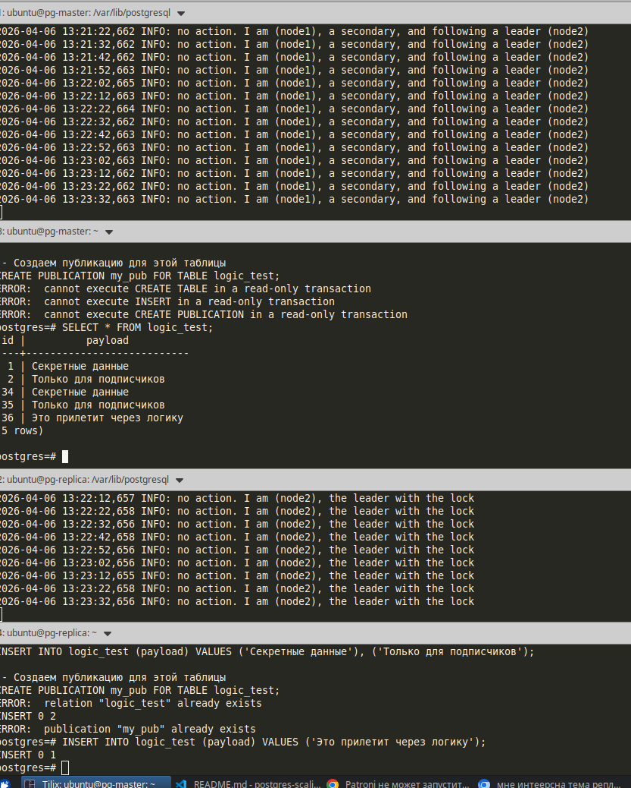

Проверка включена ли логическая репликация
```bash
sudo -u postgres psql -c "SHOW wal_level;"
```
Уроверь логической репликации лучше поменять этой командой
```bash
sudo -u postgres ETCDCTL_API=3 patronictl -c /etc/patroni.yml edit-config
```
Дополнить
```bash
+postgresql:
+  parameters:
+    wal_level: logical
+    max_replication_slots: 10
+    max_wal_senders: 10
```
Потом перезагрузить
```bash
 ETCDCTL_API=3 /usr/bin/patroni /etc/patroni.yml
```

## Проверка публикации
Зайти на лидере
```bash
sudo -u postgres psql
```

Сделать публикацию
```SQL
CREATE TABLE logic_test (id serial PRIMARY KEY, payload text);
INSERT INTO logic_test (payload) VALUES ('Секретные данные'), ('Только для подписчиков');

-- Создаем публикацию для этой таблицы
CREATE PUBLICATION my_pub FOR TABLE logic_test;
```
В лидере делаем
```SQL
INSERT INTO logic_test (payload) VALUES ('Это прилетит через логику');
```

На реплике получаем
```bash
SELECT * FROM logic_test;
```

###  Логическая репликация (Pub/Sub)

В отличие от потоковой репликации Patroni, которая копирует весь сервер целиком в режиме "только чтение", логическая репликация позволяет выборочно передавать данные между независимыми базами данных, открытыми на запись.

**Схема работы публикации и подписки:**

*На схеме показано, как данные из конкретной таблицы `logic_test` на узле-издателе (Publisher) передаются узлу-подписчику (Subscriber) через слот логической репликации.*

#### Ключевые особенности этого этапа:
1. **Выборочность**: Мы реплицируем только таблицу `logic_test`, а не всю базу данных.
2. **Независимость**: Узел-подписчик является полноценным мастером для своих данных и может принимать записи от других приложений.
3. **Требование к структуре**: Перед запуском репликации структура таблицы (DDL) должна быть создана на обоих узлах вручную, так как логическая репликация передает только данные (DML).
4. **Уровень логов**: Для работы этого механизма параметр `wal_level` на издателе был изменен на `logical`.


