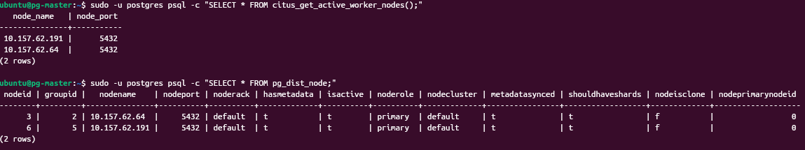
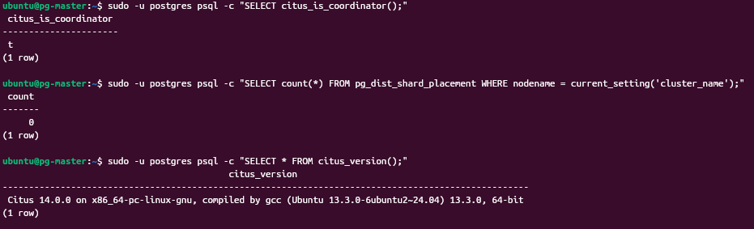

Создать ещё один узел
```bash
# В терминале вашего основного компьютера
multipass launch --name pg-worker --memory 2G --cpus 2
```

Установка citus
```bash
sudo apt install -y postgresql-16 postgresql-server-dev-16

curl https://install.citusdata.com/community/deb.sh > add-citus-repo.sh
sudo bash add-citus-repo.sh

sudo apt install -y postgresql-16-citus-13.2
```


```bash
sudo pg_conftool 16 main set shared_preload_libraries citus
sudo systemctl restart postgresql
sudo -u postgres psql -c "CREATE EXTENSION citus; SELECT citus_version();"
```

Мастер делаем координатором. Предварительно я его сделал PATRONI-лидером
```bash
sudo -u postgres psql -c "SELECT citus_set_coordinator_host('IP_MASTER', 5432);"
```

## Добавить worker
Чтобы добавить worker может понадобиться разрешение на чтение postgresql из сети в конфигурациях
```bash
 sudo -u postgres psql -c "SELECT * FROM citus_add_node('10.157.62.64', 5432);"
 ```
Посмотреть информацию worker
```bash
 sudo -u postgres psql -c "SELECT * FROM citus_get_active_worker_nodes();"
 sudo -u postgres psql -c "SELECT * FROM pg_dist_node;"
 ```



## Работа с данными
### Проверка 1
```bash
sudo -u postgres psql -c "CREATE TABLE test_sharding (id int PRIMARY KEY, data text);"

sudo -u postgres psql -c "INSERT INTO test_sharding (id, data) SELECT i, 'строка ' || i FROM generate_series(1, 100) i;"

```
Шарды улетают в воркеры.
План запроса на воркерах
```SQL
 EXPLAIN (VERBOSE) SELECT * FROM test_sharding WHERE id = 42;
``` 

### Проверка 2
```SQL
-- На координаторе (pg-master)
SELECT citus_add_node('10.157.62.64', 5432);  -- Worker 1
SELECT citus_add_node('10.157.62.191', 5432); -- Worker 2

-- Создание и распределение таблицы
CREATE TABLE orders (id int PRIMARY KEY, total_price numeric);
SELECT create_distributed_table('orders', 'id');
```


Шарды улетаю 50 на 50
```bash
postgres=# SELECT 
    s.shardid, 
    n.nodename, 
    n.nodeport, 
    s.shardminvalue, 
    s.shardmaxvalue 
FROM pg_dist_shard s
JOIN pg_dist_placement p ON s.shardid = p.shardid
JOIN pg_dist_node n ON p.groupid = n.groupid
WHERE s.logicalrelid = 'orders'::regclass
ORDER BY s.shardid;
 shardid |   nodename    | nodeport | shardminvalue | shardmaxvalue 
---------+---------------+----------+---------------+---------------
  102042 | 10.157.62.191 |     5432 | -2147483648   | -1
  102043 | 10.157.62.64  |     5432 | 0             | 2147483647
(2 rows)

```

Показать план запроса
```bash
postgres=# EXPLAIN (VERBOSE) SELECT * FROM orders WHERE id = 42;
                                                    QUERY PLAN                                                     
-------------------------------------------------------------------------------------------------------------------
 Custom Scan (Citus Adaptive)  (cost=0.00..0.00 rows=0 width=0)
   Output: remote_scan.id, remote_scan.total_price
   Task Count: 1
   Tasks Shown: All
   ->  Task
         Query: SELECT id, total_price FROM public.orders_102043 orders WHERE (id OPERATOR(pg_catalog.=) 42)
         Node: host=10.157.62.64 port=5432 dbname=postgres
         ->  Index Scan using orders_pkey_102043 on public.orders_102043 orders  (cost=0.15..8.17 rows=1 width=36)
               Output: id, total_price
               Index Cond: (orders.id = 42)
(10 rows)
```


 